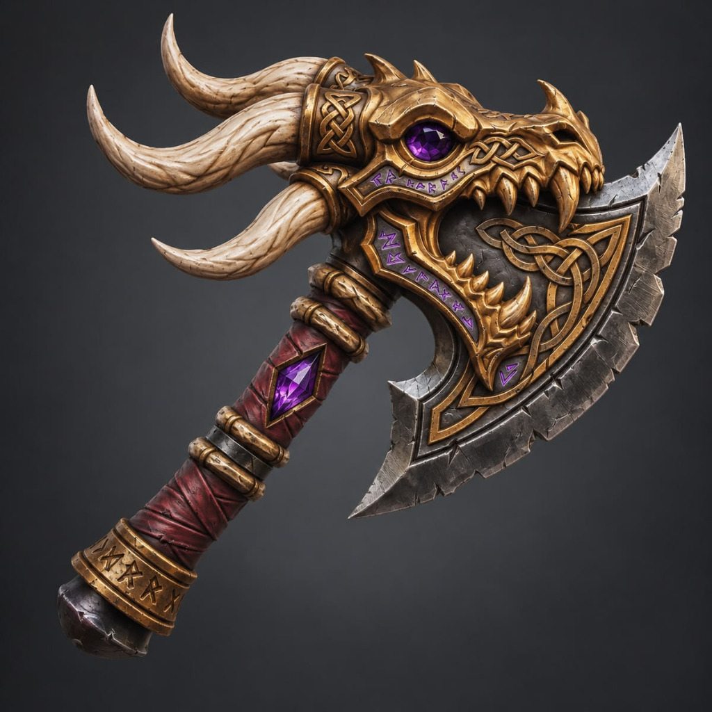
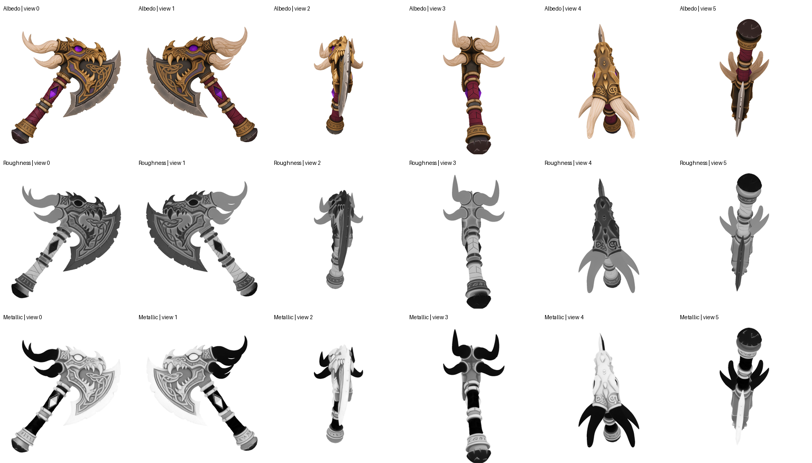

<div align="center">

# MIKU
### Material Invariance and Knowledge Unification for PBR Generation

**Yajie Bao**<sup>1,2</sup>, **Jiaye Fu**<sup>3,2</sup>, **Youtian Lin**<sup>1</sup>, **Shuang Wu**<sup>1,2</sup>, **Jiachen Qian**<sup>4,2</sup>, **Feihu Zhang**<sup>2</sup>, **Xun Cao**<sup>1</sup>, **Yao Yao**<sup>1</sup>

<sup>1</sup> Nanjing University · <sup>2</sup> DreamTech · <sup>3</sup> Peking University · <sup>4</sup> The University of Hong Kong

[](docs/paper.pdf)
[](https://linxizhi.github.io/MIKU/)
[](https://huggingface.co/datasets/linxizhilll/MIKU)

**Congratulations 🎉 Accepted to SIGGRAPH Asia 2026!**

</div>


MIKU generates multi-view albedo from a reference image and mesh geometry, predicts metallic–roughness maps, then bakes and inpaints the views into UV textures and a PBR GLB.

## News

- **[2026-11-01]** Optional 4-step Turbo albedo inference is supported. Base remains the default.
- **[2026-10-31]** Inference code is available. Model weights and download links will be provided separately.

## Open Material Studio

From the repository root, run:

```bash
python3 tools/preview_glb.py
```

Your browser opens with the **Dragonbone Axe**, the single bundled demo. Drag a `.glb` into the page to view your own model. You only need **Python 3.9+ and a browser with WebGL 2**; no inference environment, model weights or package installation is required. Keep the terminal open, and press **Ctrl+C** to stop the viewer.

The Midnight Editorial interface includes HDR studio lighting, real-time and path-traced rendering, and 4K PNG export. Choose **full PBR**, **Albedo**, **geometry normals**, or **clay** to inspect the model.

On macOS, run `chmod +x scripts/open_studio.command` once, then double-click [`scripts/open_studio.command`](scripts/open_studio.command). See the [viewer guide](viewer/README.md) for controls and more launch options.

## Installation

Inference requires **Linux x86_64, Python 3.10, CUDA 12.4, PyTorch 2.6.0** and an NVIDIA GPU.

Install the NVIDIA driver and **CUDA toolkit 12.4** (including `nvcc`), a C++ compiler (GCC/G++ 11) and Python development headers before building. Python dependencies, including the CUDA-enabled PyTorch wheels and extension build tools, are pinned in `requirements.txt`; system drivers and the CUDA toolkit are installed separately.

```bash
git clone https://github.com/linxizhi/MIKU.git
cd MIKU
conda create -n miku python=3.10 -y
conda activate miku
python -m pip install -r requirements.txt
bash scripts/build_miku_extensions.sh
```

The build produces the custom CUDA rasterizer and C++ UV inpainting module inside the checkout. It detects the visible GPU architecture. For a build machine without a visible GPU, set `TORCH_CUDA_ARCH_LIST` for the target hardware. Set `CUDA_HOME` if the toolkit is not at `/usr/local/cuda`, and `MAX_JOBS` to control compiler parallelism.

### AutoPack source and installation

The original **AutoPack** C++17/pybind11 extension is included in [`extra_libs/AutoPack/`](extra_libs/AutoPack). After installing `requirements.txt`, build and install it in the activated environment with:

```bash
python -m pip install --no-build-isolation --no-deps ./extra_libs/AutoPack
python -c "import AutoPack; print(AutoPack.__file__)"
```

The build tools are already listed in `requirements.txt`. AutoPack itself runs on the CPU and requires no CUDA toolkit or model weights. Its import name is case-sensitive: `AutoPack`. See the [AutoPack guide](extra_libs/AutoPack/README.md) for the packing API and rotation settings.

**Current inference path:** the default MIKU pipeline uses the Python pack/unpack implementation included in [`utils/miku_multiview_utils.py`](utils/miku_multiview_utils.py), with NumPy and Pillow from `requirements.txt`. Installing the standalone AutoPack extension is optional for this path; it is provided for workflows that call `AutoPack.pack_main_loop` directly.

## Model weights

**Model weights are distributed separately.** MIKU Base, optional Turbo albedo, and PBR adapter weights are not included and their download links are pending. Place the downloaded weights in the following layout before running inference:

```text
checkpoints/
├── flux2-klein-base-9b/              # complete FLUX.2 Klein base-9B Diffusers snapshot
│   ├── model_index.json
│   ├── scheduler/
│   ├── tokenizer/
│   ├── text_encoder/
│   ├── transformer/
│   └── vae/
├── albedo/                         # MIKU Base albedo adapter (default)
│   └── pytorch_lora_weights.safetensors
├── albedo_turbo/                   # optional MIKU Turbo albedo adapter
│   └── pytorch_lora_weights.safetensors
├── pbr/
│   ├── pytorch_lora_weights.safetensors
│   └── dino_linear.pt
└── dinov2/
    └── dinov2_vitl14_reg4_pretrain.pth
```

Both MIKU Base and Turbo load the same **FLUX.2 Klein base-9B** backbone from `flux2-klein-base-9b/`. Turbo is a separate MIKU albedo adapter. The DINO backbone is **ViT-L/14 with four registers**. The inference-only backbone code is included, so neither a DINO training checkout nor a hidden Torch Hub cache is required. Base-model and DINO weights retain their upstream licenses.

The `albedo_turbo/` directory is optional and is only read when selecting the Turbo configuration. Place the Turbo adapter there as `pytorch_lora_weights.safetensors`; if its downloaded filename is `adapter_diffusers.safetensors`, rename it when copying. Keep the Base adapter in `albedo/`.

By default, paths are resolved under this repository's `checkpoints/` directory. Use `--weights-dir /path/to/checkpoints` or `MIKU_CHECKPOINT_DIR` to select another root. Individual relative paths in the selected YAML configuration are resolved against that root; absolute path overrides remain supported. Missing files produce an explicit error before model loading. Inference reads local weights and does not download them implicitly.

```bash
python tools/check_weights.py
# Alternative location:
python tools/check_weights.py --weights-dir /path/to/checkpoints
```

## Inference

The default uses the **MIKU Base albedo adapter** with [`cfgs/miku.yaml`](cfgs/miku.yaml). The example is the axe in [`assets/axe/`](assets/axe), including the **50,000-triangle input mesh** and its reference image; no additional mesh simplification is needed. After installation and weight setup, run:

```bash
bash scripts/run_miku.sh
```

This reads `assets/axe/mesh.glb` and `assets/axe/image.png`, and writes `outputs/axe/textured_mesh.obj` and `outputs/axe/textured_mesh.glb`. Running `python infer_miku.py` uses the same defaults. Default paths are resolved from the repository root.



For your own example, provide both `--mesh` and `--image`:

```bash
bash scripts/run_miku.sh \
  --mesh inputs/mesh.glb \
  --image inputs/reference.png \
  --output outputs/custom/textured_mesh.obj
```

The mesh is normalized for rendering and exported back in its original coordinates. UVs are unwrapped by default; the same six cameras are used for conditioning, prediction and baking.

This runs **albedo → MR → UV baking → vertex/OpenCV inpainting → OBJ and GLB export**. The GLB embeds lossless albedo and metallic–roughness textures. In glTF, **G = roughness** and **B = metallic**.

| Setting | Default | CLI override |
| --- | --- | --- |
| Geometry render / restored camera view | 1024 × 1024 | `--render-size 1024 --resolution 1024` |
| UV texture | 2048 × 2048 | `--texture-size 2048` |
| Albedo steps / seed / geometry CFG | 10 / 0 / 2.0 | `--steps 10 --seed 0 --guidance 2` |
| Albedo packed canvas longest side | 2048 | `miku_max_canvas_size` in YAML |
| PBR steps / seed | 20 / 99 | `--pbr-steps 20 --pbr-seed 99` |
| PBR layout | `pack` | `--pbr-mode pack` or `--pbr-mode nonpack` |
| MR background whitening | enabled | `--no-pbr-background-white` to disable |
| Model offload | model CPU offload | `--offload model` for albedo; `pbr_offload` in YAML |

**Pack:** resize the generated albedo atlas to half its width and height, then pad the right/bottom edge to a multiple of 16. **Nonpack:** restore the six full camera frames, resize each to 512 × 512 and arrange a 3 × 2 **1536 × 1024** grid. Both layouts preserve view order and restore the original camera frames before baking.

The renderer's geometry masks are passed to MR postprocessing. Background pixels become white after prediction; foreground values are preserved. Raw float and PNG predictions are kept separately in the debug directory. Geometry CFG for albedo preserves the reference image and masks out geometry latents in the unconditional branch.

```bash
# Run the default axe with a different weight directory and nonpack MR.
bash scripts/run_miku.sh --weights-dir /path/to/checkpoints \
  --pbr-mode nonpack --output outputs/nonpack/textured_mesh.obj

# Preview the default axe geometry without loading any model weights.
bash scripts/run_miku.sh --conditions-only \
  --output outputs/conditions/textured_mesh.obj

# Skip MR, or save predicted views without baking.
# Add --albedo-only or --mv-only to a normal inference command.
```

Outputs include `textured_mesh.glb`, OBJ/MTL, albedo PNG, roughness PNG, metallic PNG and a combined MR PNG. `textured_mesh_debug/` stores geometry masks, normal/position conditions, packing metadata, six-view predictions and inference reports.

### Optional Turbo inference

Use [`cfgs/miku_turbo.yaml`](cfgs/miku_turbo.yaml) to select the Turbo albedo adapter and its **4-step** settings:

```bash
bash scripts/run_miku.sh --config cfgs/miku_turbo.yaml \
  --output outputs/axe_turbo/textured_mesh.obj
```

This runs the same complete **albedo → MR → UV baking → inpainting → OBJ/GLB export** workflow on the bundled axe. Add `--preview` to open the exported GLB, or provide `--mesh` and `--image` for your own asset. `--weights-dir` also applies to the Turbo configuration.

| Albedo setting | Base (default) | Turbo (optional) |
| --- | --- | --- |
| Configuration | `cfgs/miku.yaml` | `cfgs/miku_turbo.yaml` |
| Adapter under `checkpoints/` | `albedo/pytorch_lora_weights.safetensors` | `albedo_turbo/pytorch_lora_weights.safetensors` |
| Inference steps | 10 | **4** |
| Guidance scale | 2.0 | **1.0** |
| Precision | float16 | **bfloat16** |
| Seed | 0 | 0 |

Turbo uses the existing pipeline scheduler with `num_inference_steps=4`. At guidance 1.0, albedo prediction does not run the geometry-masked unconditional branch. Both configurations use packed albedo conditions, 1024 × 1024 geometry views, 2048 × 2048 UV textures, and the same **20-step pack-mode PBR adapter** with MR background whitening. Turbo's four-step setting applies to albedo only.

The Turbo configuration was verified with a complete Dragonbone Axe run, including four albedo steps, MR mask/channel checks and embedded GLB texture validation. Running `bash scripts/run_miku.sh` without `--config` continues to use Base.

### Default example output

Six predicted views from the bundled axe example, using the default settings above. From top to bottom, the rows show **Albedo**, **Roughness**, and **Metallic**. These views are baked into the exported PBR GLB.



### Interactive material viewer

The included browser viewer opens the generated axe with HDR studio lighting, a reflective floor and orbit controls. Optional **Photography (PT)** mode uses progressive path tracing for indirect lighting and rough reflections; hold the camera still to converge, then export a 4K PNG. Static models without vertex normals receive smooth normals with preserved creases in the viewer. See [viewer/README.md](viewer/README.md) for controls and dependencies. Drag a self-contained **GLB** into the page to inspect another exported result. Model files are read locally in your browser; they are not uploaded. Presentation lighting changes the view without modifying the model's material textures.

```bash
# Open an existing export.
python3 tools/preview_glb.py --model outputs/axe/textured_mesh.glb

# Automatically open the result after inference and GLB export.
bash scripts/run_miku.sh --preview
```

The viewer uses Python's standard library and the prebuilt files in `viewer/dist/`. A desktop browser with WebGL 2 support is required. The local server binds to `127.0.0.1:8765`; use `--port 0` to select a free port (`--preview-port 0` during inference). `--no-open` prints the address without opening a browser. Stop a foreground viewer with Ctrl+C; an inference-launched viewer prints its process ID and stop command.

For inference on a remote machine, `--preview` starts the viewer there and prints port-forwarding instructions. On your desktop, run `ssh -L 8765:127.0.0.1:8765 <user>@<server>`, then open the printed viewer URL. Alternatively, copy the exported GLB to your desktop and drag it into a locally running viewer. No changes to the remote GPU environment are needed for viewing.

## Repository structure

```text
MIKU/
├── assets/axe/                     # default 50K-triangle mesh and reference image
├── infer_miku.py                    # command-line inference
├── mikuPipeline.py                  # albedo → MR orchestration
├── miku_config.py
├── cfgs/miku.yaml                  # default Base inference
├── cfgs/miku_turbo.yaml            # optional 4-step Turbo albedo inference
├── miku/                           # model forward and strict checkpoint loading
│   └── vendor/dinov2/              # inference backbone subset + license
├── DifferentiableRenderer/         # rendering, UV baking and inpainting
├── custom_rasterizer/              # CUDA extension source
├── extra_libs/AutoPack/             # standalone C++ packing source and install guide
├── utils/                          # view packing, masking and UV utilities
├── scripts/                        # build and inference launchers
├── tools/                          # checkpoint and exported-result validation
├── viewer/                         # browser material viewer and generated axe demo
├── tests/                          # inference regression checks
├── requirements.txt
└── docs/                           # project page and paper assets
```

The release contains no training entry point, dataset pipeline, optimizer or training-resume utilities. Checkpoints, local inference runs and locally built inference extensions are excluded from version control. The viewer runtime and generated axe demo are included for immediate preview.

## Acknowledgments

MIKU builds upon prior work in texture and physically based material generation, including [LumiTex](https://github.com/LumiTexPBR/LumiTex), [UniTEX](https://github.com/YixunLiang/UniTEX), and [MaterialMVP](https://github.com/ZebinHe/MaterialMVP). We thank their authors for the ideas and publicly shared resources that helped make this work possible.

We also thank Black Forest Labs for [FLUX.1-dev](https://huggingface.co/black-forest-labs/FLUX.1-dev), the [Diffusers](https://github.com/huggingface/diffusers) contributors for their diffusion-model library, and [Hugging Face](https://huggingface.co/) for its model and dataset sharing platform.

Third-party source and license notes are listed in [THIRD_PARTY_NOTICES.md](THIRD_PARTY_NOTICES.md).
